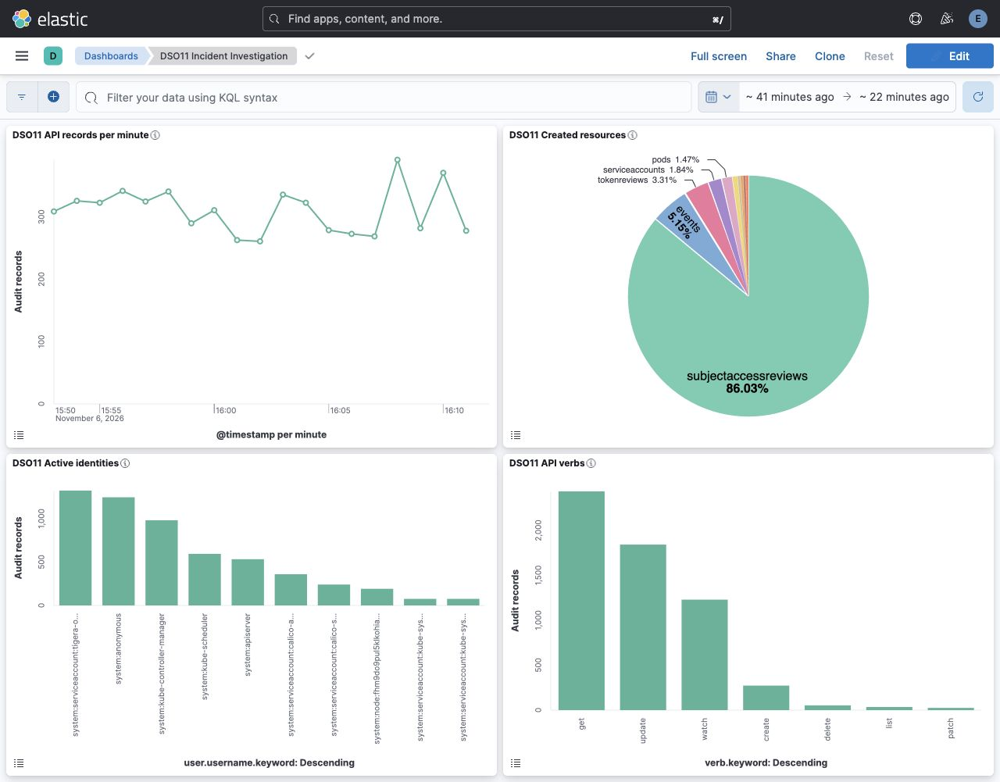
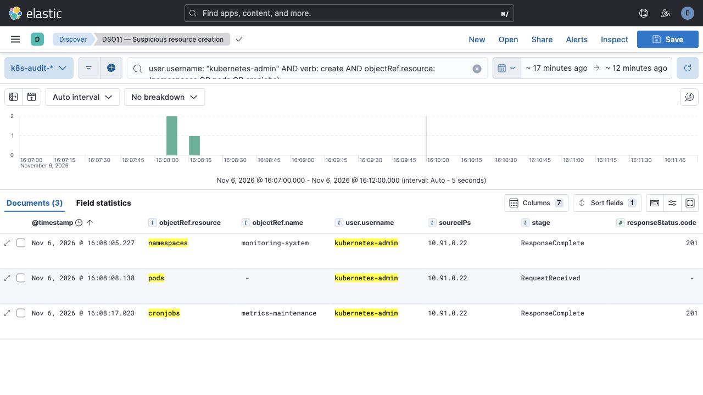
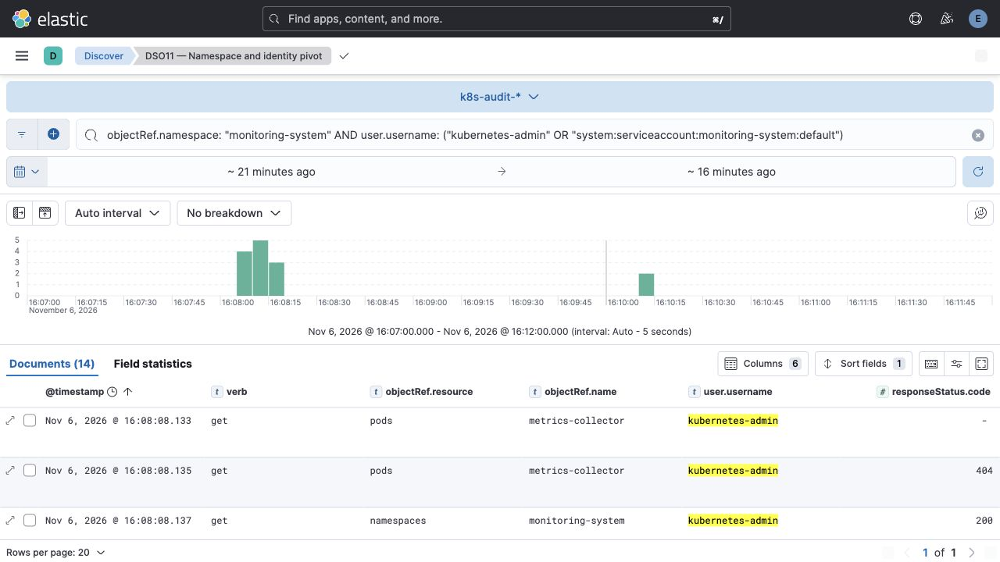
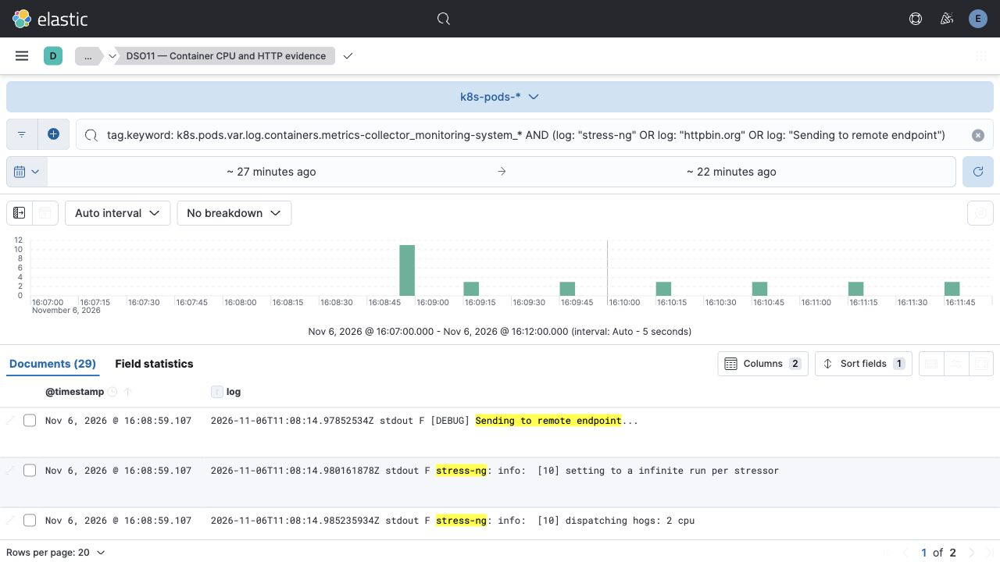
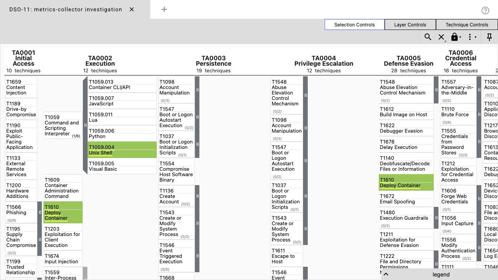

# Расследование инцидента в Kubernetes — DSO-11

**Автор:** s2417991, при помощи Codex. **Дата:** 6 ноября 2026 года.  
**Классификация:** учебный инцидент злоупотребления вычислительными ресурсами с маскировкой под мониторинг.  
**Статус:** расследование завершено; на момент фиксации workload продолжал работать, устранение не выполнялось.

## Executive Summary

В namespace `monitoring-system` от имени `kubernetes-admin` создан под `metrics-collector`, который вместо заявленного сбора метрик запускает `stress-ng --cpu 2 --cpu-load 80 --timeout 0` и отправляет тестовый JSON на внешний HTTP-сервис. Прямое измерение показало около 1,6 CPU у пода; созданный рядом CronJob `metrics-maintenance` выполняется каждые пять минут, но фактически не восстанавливает под: его код только печатает сообщения, а проверка пода получает HTTP 403. В рамках учебного сценария это инцидент: поведение и назначение workload расходятся; способ первоначального получения административного доступа, майнинг, утечка секретов и выход на хост доказательствами не установлены.

## 1. Исходные условия и границы расследования

SRE сообщил о нагрузке около 80% в 02:00–05:00. **Этот интервал не подтверждается доступными данными:** новая ВМ стартовала примерно в 10:47 UTC, а события в SIEM начинаются около 10:52:59 UTC 06.11.2026. Обнаруженная цепочка начинается в **11:08 UTC / 16:08 Asia/Yekaterinburg**. Переносить её на вымышленную ночь нельзя; для проверки исходного сообщения потребуются исторические логи/метрики старой среды.

В отчёте время приведено в **UTC**, если не указано иначе. Kibana на скриншотах отображает локальное время **UTC+5**. Основное окно расследования — 11:07–11:12 UTC; baseline — 10:53–11:08 UTC. Первый SSH-вход расследователя — 11:13:00 UTC. Последующие `kubectl logs`, `get`, `top`, `exec ps aux` и `exec netstat` относятся к сбору доказательств, а не к атакующему.

Источники: `k8s-audit-*`, `k8s-pods-*`, `linux-auth-*`, `linux-audit-*`, исходный `/var/log/kubernetes/audit/audit.log`, манифесты Kubernetes, процессы и соединения. Данные DSO-09 и DSO-10 не использованы. Изменялись только представления/сохранённые поиски Kibana; исходные журналы и исследуемые ресурсы не редактировались. Запросы расследователя сами оставляют новые audit-события.

## 2. Triage: от симптома к подозрительному workload

### Baseline и аномалии

В baseline обнаружено 4 571 audit-запись: `get` — 1 899, `update` — 1 471, `watch` — 950, `create` — 190, `delete` — 39, `list` — 13, `patch` — 9. Это краткий baseline недавно созданного стенда, а не профиль обычной production-недели. В окне 11:08–11:12 — 1 323 записи, из них 83 `create`; сами объёмы не доказывают атаку. Подробные агрегации ресурсов/пользователей сохранены в [baseline](evidence/baseline-statistics.json) и [incident](evidence/incident-statistics.json).

Это количества **audit-записей**, а не уникальных API-запросов: несколько стадий одного запроса объединяются по `auditID`. Для анализа созданы график событий по минутам и top values по ресурсам, пользователям и verb в dashboard `DSO11 Incident Investigation`.



Фильтр создания namespace/pod/CronJob от `kubernetes-admin` выделил компактную последовательность в 11:08. Редкое создание двух несистемных workload, публичные образы `latest`, описание «Prometheus metrics aggregation service» при запуске CPU stress и внешние HTTP-запросы вместе дают основание для расследования. Один только `latest` или внешний registry не является доказательством вредоносности.



### Проверка на системе

В [runtime-check.txt](evidence/runtime-check.txt) зафиксированы `kubectl top`, логи подов, `ps` и сетевые соединения. `metrics-collector` потреблял **1 602m CPU и 7 MiB**; нода — **2 697m CPU / 33%**, около 75% памяти. Два процесса `stress-ng-cpu` использовали примерно по 79,8% одного ядра. Это согласуется с командой нагрузки, но **не подтверждает 80% всей восьмиядерной ноды** или длительность «несколько часов».

## 3. Timeline

Для Kubernetes используется точный `stageTimestamp` стадии `ResponseComplete` из оригинального audit-файла. Для stdout/stderr — CRI timestamp внутри `log`, а не время доставки в ES. Полные auditID и записи находятся в [audit-events.json](evidence/audit-events.json), ID документов ES — в [pod-log-excerpts.json](evidence/pod-log-excerpts.json).

| Время UTC, 2026-11-06 | Событие и интерпретация | Источник / идентификатор |
|---|---|---|
| 11:08:01.723654 | `kubernetes-admin` проверяет разрешения через `selfsubjectrulesreviews`, ответ 201. Начало наблюдаемой разведки; первичный доступ произошёл ранее или вне доступных данных. | raw k8s audit, `stageTimestamp`, auditID `2993781b-f5a8-44d5-825e-26d11b1aa2d9` |
| 11:08:02.800411 | Список namespaces, ответ 200. | raw k8s audit, auditID `5cadc193-8461-49dc-a2c5-3d480110381d` |
| 11:08:04.137023 | Список ResourceQuota, ответ 200. | raw k8s audit, auditID `2c561636-6904-4017-8a59-a2919bd213f8` |
| 11:08:05.226155 | Создан namespace `monitoring-system`, ответ 201. | raw audit + `k8s-audit-2026.11.06`, auditID `f2064347-2325-49d9-bd36-7b4fb37d4bbf` |
| 11:08:08.146652 | Создан под `metrics-collector`, ответ 201; shell-команда содержит `stress-ng` и HTTP POST. | raw audit, auditID `d2f4227c-76d4-440b-84ca-3374607f23c8`; в SIEM найдена только стадия RequestReceived этого создания |
| 11:08:13.683100447 | Контейнер пишет «Metrics collector starting…». | `k8s-pods-2026.11.06`, `log`; документ `J0CMsKEBq35JGyd5RiPG` |
| 11:08:14.985235934 | `stress-ng` сообщает «dispatching hogs: 2 cpu». Фактический запуск CPU-нагрузки. | `k8s-pods-2026.11.06`, `log`; документ `LkCMsKEBq35JGyd5RiPG` |
| 11:08:15.229137364 | Ответ внешнего сервиса содержит URL `http://httpbin.org/post`; отправляется демонстрационный JSON метрик. | `k8s-pods-2026.11.06`, CRI timestamp в `log`; документ `PUCMsKEBq35JGyd5RiPG` |
| 11:08:17.023050 | Создан CronJob `metrics-maintenance`, расписание `*/5 * * * *`, ответ 201. | raw audit + `k8s-audit-2026.11.06`, auditID `d99bbe32-128e-4f23-b241-0208e85ae7ad` |
| 11:10:01.081774 | Контроллер CronJob создаёт Job `metrics-maintenance-29899390`, ответ 201. Это автоматическое продолжение расписания. | raw k8s audit, auditID `aa15b601-d12a-49a0-9dda-d732c9c5d2bd` |
| 11:10:11.723360 | SA `system:serviceaccount:monitoring-system:default` пытается прочитать `metrics-collector` и получает **403 Forbidden**. | raw audit + `k8s-audit-2026.11.06`, auditID `8cf205d3-a180-4319-8913-4de3bb40fd58` |
| 11:10:11.729579655 | Job печатает «Recovery workflow initiated». Это `echo`, а не успешное восстановление. | `kubectl logs` с timestamps, runtime-check.txt |

Отдельная линия расследования: SSH исследователя в 11:13:00; снимок процессов/метрик в 11:14:46; копирование журналов в 11:14:21–11:14:22 UTC. Время получения сообщения SRE неизвестно, поэтому MTTD/MTTR не вычислялись.

## 4. Scope и индикаторы

| Объект | Наблюдение |
|---|---|
| Namespace | `monitoring-system`; создан в рассматриваемой цепочке |
| Инициатор API | `kubernetes-admin`, группа `kubeadm:cluster-admins`, `sourceIPs: [10.91.0.22]` — адрес самой ноды. Это техническая идентичность, не установленный человек |
| Нода | `fhm9do9pul5klkohia9h`, 10.91.0.22; под размещён на ней |
| Основной под | `metrics-collector`, UID `41ec80a2-afa2-4b78-a367-56e1b9ab91b5`, IP 10.200.180.10, контейнер `collector` |
| Образ пода | `alpine:latest`; фактический digest `sha256:3f4d6b32e26703c6082839234f43769d5046b3ac7c910033911d1e71d8cd630a` |
| Конфигурация | `/bin/sh -c`, установка `stress-ng curl`, бесконечная нагрузка и POST каждые ~30 секунд; limit CPU 2, memory 256Mi; request CPU 100m, memory 64Mi |
| Привилегии | `privileged`/`hostPID`/hostPath корня не обнаружены. Используется default SA и стандартный projected token volume; наличие тома не доказывает кражу токена |
| Расписание | CronJob `metrics-maintenance`; Job `metrics-maintenance-29899390`; под Job `metrics-maintenance-29899390-bmb4p`, IP 10.200.180.11 |
| Образ Job | `bitnami/kubectl:latest`, digest `sha256:8f59408f9e896fc8992a0660a56687545bd06751f26531b4a26fca6d5dc7562d` |
| Исходящий трафик | URL `http://httpbin.org/post`; в сетевом снимке TIME_WAIT к 3.221.253.123:80 и 54.172.45.38:80. Это контекстные индикаторы стенда, не универсальный blacklist |
| Payload POST | `source: node-metrics-collector`, `metrics_count: 1500`, `batch_id: 42`; секретов в просмотренном payload нет |

Манифесты и статусы: [resources.json](evidence/resources.json). `httpbin.org` используется как HTTP echo endpoint; сам домен и публичные Alpine/kubectl-образы не объявляются вредоносными.

В интервале активности инициатора не обнаружены успешные обращения к Secrets, создание/изменение RBAC, атакующий `pods/exec`, новые DaemonSet или mutating webhook. [Инвентаризация запросов инициатора](evidence/actor-request-inventory.json) позволяет проверить это утверждение в пределах выбранного окна. Default SA создан штатным контроллером; основания считать его специально созданным привилегированным аккаунтом нет. Системные RBAC-события первоначального развёртывания кластера не включены в атаку.

## 5. Корреляция источников и persistence

Связь строится по namespace + имени/UID пода + последовательности времени. `k8s-audit-*` показывает создание объектов от администратора. В `k8s-pods-*` на этом стенде привязка к поду доступна в **`tag.keyword`**, содержащем имя пода и namespace; готовых ECS-полей Kubernetes для этого поиска не потребовалось. CRI-время подтверждает запуск нагрузки спустя примерно семь секунд после создания пода. Манифест и `ps` независимо подтверждают ту же команду, `netstat` — исходящие HTTP-соединения.





**Закрепление:** объект CronJob обеспечивает регулярное выполнение shell/kubectl, поэтому он является артефактом, требующим удаления при последующем устранении. Однако его код содержит только `kubectl get pod` и `echo`; команды `create/apply` для восстановления отсутствуют. Более того, default SA получает 403 на чтение пода. Условие `if ! kubectl get ...` трактует любую ошибку как отсутствие сервиса и печатает ложное сообщение о восстановлении. **Работающий механизм самовосстановления `metrics-collector` не доказан и в просмотренном коде не реализован.** Удаление только пода оставит CronJob, но этот CronJob сам под не пересоздаст.

[Выборка аутентификации и обзор Linux audit](evidence/linux-log-review.json).

**Linux auth:** до действий расследователя виден инфраструктурный вход `all-infa-probe` по публичному ключу в 10:53:06 с 10.91.0.4. Вход `ubuntu` в 11:13:00 с того же шлюза относится к расследованию. Наблюдений SSH brute force или успешного входа по паролю, объясняющих первичный доступ, нет.

**Linux audit:** индекс содержал 501 запись, последняя около 10:56:54, то есть до цепочки; `auditctl -l` возвращает `No rules`. Эти данные не обеспечивают аудит выполнения команд в нужный период. Отсутствие записей не доказывает отсутствие действий на хосте.

**Пробел SIEM:** ResponseComplete создания пода есть в исходном audit-файле с кодом 201, но не найден в Elasticsearch. В Kibana видна RequestReceived без `objectRef.name`/кода. Timeline дополнен исходником, а не искусственными документами ES. Точная причина потери этой стадии не установлена в рамках расследования; её следует диагностировать отдельно. У stdout время доставки `@timestamp` также отличается: событие 11:08:13.683 пришло как 11:08:59.107. Поэтому порядок по ingest timestamp не заменяет порядок по времени события.

## 6. Root Cause Analysis — 5 Whys

| Почему? | Ответ и статус доказательства |
|---|---|
| 1. Почему возникла лишняя CPU-нагрузка? | Два worker-процесса `stress-ng` работают с целевой загрузкой 80% и без таймаута. Подтверждено логами, манифестом и процессами. |
| 2. Почему stress-ng запущен в сервисе мониторинга? | Стартовый shell пода устанавливает и запускает его, хотя имя/описание обозначают сбор метрик. Подтверждено конфигурацией. Это не случайная ошибка отображения CPU. |
| 3. Почему такой workload удалось создать? | API принял запрос `kubernetes-admin` с cluster-admin-группой и вернул 201. Идентичность обладала достаточными правами. Как она оказалась у инициатора, неизвестно. |
| 4. Почему применение этой идентичности привело к длительной нагрузке и внешнему трафику? | В исследованном namespace нет ResourceQuota, LimitRange и NetworkPolicy; допускается произвольный shell в публичном образе `latest`. Pod CPU limit 2 ограничивает максимум, но не предотвращает скрытое постоянное потребление. Наблюдаемый POST показывает, что путь наружу фактически разрешён. |
| 5. Почему платформа не пресекла несоответствие назначению? | В наблюдаемом пути развёртывания отсутствует эффективный независимый барьер, проверяющий одобренный образ/манифест и допустимое поведение после административного API-запроса. Исправимая системная проблема — опора на административное разрешение без достаточных ограничений workload и контроля исполнения. Отсутствие формального review, слабое хранение kubeconfig или конкретная организационная причина — гипотезы для проверки у владельца платформы, не установленный факт. |

[Снимок политик и audit rules](evidence/security-controls.txt) подтверждает технические ограничения этого вывода. Нельзя делать вывод «пароль украли» только из использования `kubernetes-admin`. Следующий шаг по initial access: сверить выдачу/использование admin kubeconfig, журналы шлюза и историю авторизованных развёртываний с владельцем среды; не публиковать содержимое credentials.

## 7. Impact и реагирование

Подтверждённый ущерб — ненужное потребление примерно 1,6 CPU и регулярный внешний HTTP-трафик из одного пода на одной ноде. При восьми CPU это около 20% суммарной вычислительной ёмкости, а не 80%. Просмотренный трафик раскрывает имя пода и фиктивные метрики. Финансовый ущерб, нарушение SLO, кража клиентских данных и работа криптомайнера не установлены. Наличие cluster-admin у инициатора означает высокий потенциальный blast radius, но наблюдаемый scope нельзя расширять до всего кластера без доказательств.

Расследователь сохранил журналы, манифесты, процессы, сетевой снимок, поиски и скриншоты. Workload не останавливался, credentials и RBAC не менялись; **инцидент не объявляется устранённым**. Для учебного стенда это сохраняет воспроизводимость. Для боевой среды после фиксации улик необходимы приоритетная изоляция egress, приостановка CronJob, остановка несанкционированного workload и проверка административной идентичности по согласованному плану без потери штатного доступа.

## 8. MITRE ATT&CK Mapping

Это маппинг наблюдаемого поведения, а не доказательство личности/мотива атакующего и не карта покрытия детектирования. Layer использует Enterprise ATT&CK v18 для воспроизводимости с учебными материалами; ссылки ведут на актуальные карточки техник.

| Техника | Конкретное событие | Обоснование и предел вывода |
|---|---|---|
| [T1610 — Deploy Container](https://attack.mitre.org/techniques/T1610/) | Создание `metrics-collector`, auditID `d2f4227c-76d4-440b-84ca-3374607f23c8`, код 201 | Через API развёрнут контейнер с нагрузочным shell payload. Привилегированный режим или escape для этой техники не требуются и здесь не установлены. |
| [T1059.004 — Unix Shell](https://attack.mitre.org/techniques/T1059/004/) | `/bin/sh -c` в spec и процессах: `apk`, `stress-ng`, цикл `curl` | Shell исполняет команды внутри контейнера при старте. Это не `kubectl exec` атакующего; поздний exec выполнен расследователем. |
| [T1036 — Masquerading](https://attack.mitre.org/techniques/T1036/) | Название `metrics-collector`, описание `Prometheus metrics aggregation service`, maintainer `platform-team` при CPU stress и фиктивном POST | Наблюдаемое несоответствие назначения маскирует нагрузку под инфраструктурный сервис. Аннотация не подтверждает реальное авторство platform-team. |
| [T1053.007 — Container Orchestration Job](https://attack.mitre.org/techniques/T1053/007/) | CronJob `metrics-maintenance` → Job в 11:10; auditID `d99bbe32-128e-4f23-b241-0208e85ae7ad` и `aa15b601-d12a-49a0-9dda-d732c9c5d2bd` | Планировщик обеспечивает повторное исполнение команд. Успешное восстановление основного пода или расширение привилегий не подтверждены: только echo и отказ 403. |

Не добавлены T1110 (нет доказанного brute force), T1611 (нет escape), T1609 на основе наших exec-запросов, техники кражи credentials и эксфильтрации секретов. `stress-ng` сам по себе не доказывает майнинг; HTTP echo не доказывает командный C2-канал.



Файл для импорта: [attack-navigator-layer.json](attack-navigator-layer.json). Зелёный — подтверждённое поведение; жёлтый — запланированное исполнение с ограничениями persistence.

## 9. Lessons Learned

1. Сначала проверять реальное окно данных и часовой пояс. Легенда про ночь не заменяет timestamp источника.
2. Имена «metrics» и аннотации владельца не подтверждают легитимность; проверять образ, команду, расход CPU и трафик вместе.
3. Различать `403`, `404` и логическое состояние сервиса. Строка «recovery initiated» не означает выполненное восстановление.
4. Коррелировать SIEM с исходным audit и Kubernetes. Пропуск стадии и задержка ingest могут исказить timeline.
5. Ограниченный RBAC default SA сработал; административный путь создания workload всё равно нуждается в независимых ограничениях и мониторинге.
6. Разделять действия инициатора и responder. Иначе проверочный `exec` ошибочно становится «техникой атакующего».

## 10. Action Items

Роли обозначают предлагаемых владельцев; назначение конкретных сотрудников и выполнение задач ещё не подтверждены. Все сроки — по Asia/Yekaterinburg.

| ID / приоритет | Задача | Цель | Метрика успеха | Владелец | Срок |
|---|---|---|---|---|---|
| A1 / Critical | После сохранения улик изолировать egress workload, suspend CronJob и остановить `metrics-collector`; зафиксировать контрольный снимок | Прекратить текущую нагрузку и внешние передачи | Под остановлен; CronJob suspended; за 10 минут нет новых Job/POST, CPU возвращается к измеренному baseline | Incident commander + SRE | 2026-11-06 |
| A2 / High | Сверить применение `kubernetes-admin` с владельцем, проверить источник admin kubeconfig; при несанкционированном использовании отозвать credential и заменить автоматизацию минимально необходимой ролью | Устранить повторное использование чрезмерного доступа | Инициатор и разрешённость установлены либо gap документирован; старый неразрешённый credential получает отказ; штатный деплой проходит | Kubernetes platform owner | 2026-11-07 |
| A3 / High | Ввести admission-проверку одобренного registry/образа по digest для рабочих namespace, контролируемые исключения и review изменения манифеста | Не допускать непроверенный workload и mutable latest | Тестовый `alpine:latest` отклонён, одобренный digest принят; каждое исключение имеет владельца и срок | Platform security | 2026-11-09 |
| A4 / High | Ввести default-deny egress и явный список разрешённых направлений после инвентаризации зависимостей | Ограничить несанкционированный outbound | POST на неразрешённый тестовый endpoint блокируется; DNS и нужные бизнес-соединения проходят контрольные тесты | Network/SRE | 2026-11-09 |
| A5 / Medium | Задать ResourceQuota/LimitRange и обоснованные requests/limits; алерт на длительное потребление выше профиля приложения | Снизить влияние ресурсоёмкого workload | Квоты действуют на все рабочие namespaces; тест превышения отклоняется; нагрузка вызывает сигнал ≤5 минут | SRE | 2026-11-10 |
| A6 / High | Внедрить правила D1–D4 ниже с дедупликацией по auditID, runbook и проверкой на baseline | Обнаруживать подозрительное создание, CPU stress и ошибки scheduled workload | Все положительные тесты обнаружены ≤5 минут; согласованные штатные деплои не эскалируются; reviewer получает namespace/user/sourceIP | SOC/DevSecOps | 2026-11-09 |
| A7 / High | Найти причину пропуска ResponseComplete в сборщике/индексации; парсить CRI-время отдельно от ingest, контролировать доставку | Восстановить полноту и порядок доказательств | Для 100 тестовых API-запросов все ожидаемые стадии присутствуют; CRI timestamp равен времени события; lag p95 <60 секунд | Observability engineer | 2026-11-10 |
| A8 / Medium | Настроить аудит execve и важных операций с credentials на нодах с оценкой объёма/приватности, доставку и ретеншн | Расследовать действия ОС и initial access | Тестовая команда доступна в SIEM ≤60 секунд с host/user/process; источник не молчит >5 минут без сигнала | Linux/SRE + Security | 2026-11-13 |
| A9 / Medium | Исправить maintenance-скрипт: различать 403/404, убрать ложный успех; отключать auto-mount токена, где API не нужен | Исключить ложную диагностику и ненужную доступность credentials | Тесты 403/404/200 дают разные результаты; нет «успеха восстановления» без проверенного действия | Владелец сервиса | 2026-11-10 |

A3–A5 — preventive, A6–A8 — detective; A1–A2 — response/access governance. Эти меры предложены, а не представлены как уже внедрённые.

## 11. Конкретные запросы и правила обнаружения

Сохранённые поиски [queries.json](queries.json) воспроизводят расследование. Диапазон: 06.11.2026 11:07–11:12 UTC, соответствующий 16:07–16:12 на скриншотах. Правила ниже — предложения; KQL задаёт отбор, а расписание, порог, дедупликация и исключения настраиваются отдельно. Alerting в этой работе не объявляется настроенным.

**D1. Создание workload/namespace административной идентичностью** — `k8s-audit-*`:

```kql
user.username: "kubernetes-admin" AND verb: create
AND objectRef.resource: (namespaces OR pods OR cronjobs)
```

Проверено: 3 записи в выбранном окне (namespace, RequestReceived пода, CronJob). Запуск раз в минуту, окно 5 минут, ≥1 запрос вне одобренного change; группировка по `auditID`, сообщение с username/sourceIPs/namespace/resource. Нельзя требовать только код 201 до устранения потерь стадий. Ложные срабатывания: bootstrap, разрешённый аварийный деплой; исключать по change/времени, а не все внутренние IP.

**D2. CPU stress или подозрительный endpoint в контейнере** — `k8s-pods-*`:

```kql
tag.keyword: k8s.pods.var.log.containers.metrics-collector_monitoring-system_*
AND (log: "stress-ng" OR log: "httpbin.org" OR log: "Sending to remote endpoint")
```

Это проверенный IoC-поиск данного инцидента. Для общего правила убрать ограничение конкретного пода и использовать `log: "stress-ng"` с allowlist согласованных нагрузочных тестов; коррелировать с CPU и образом, не объявлять любой HTTP endpoint атакой. ≥1 событие за 5 минут, дедупликация pod/container.

**D3. Повторяющиеся отказы SA у scheduled workload** — `k8s-audit-*`:

```kql
user.username: "system:serviceaccount:monitoring-system:default"
AND responseStatus.code: 403
```

Проверенный pivot к отказу чтения пода. Для общего правила — SA namespace и API 403, ≥2 уникальных запроса за 10 минут, сопоставление с созданным CronJob/Job. Один 403 — сигнал ошибки прав, не самостоятельное доказательство атаки.

**D4. Изменение объектов возможного закрепления** — `k8s-audit-*`:

```kql
verb: (create OR patch OR update)
AND objectRef.resource: (cronjobs OR daemonsets OR rolebindings OR clusterrolebindings OR mutatingwebhookconfigurations)
```

≥1 неразрешённое изменение вне окна эксплуатации; проверять пользователя, namespace, образ и requestObject. Ночной фильтр применять с явным рабочим календарём и часовым поясом. В этом инциденте реально найден CronJob; другие перечисленные механизмы не объявляются обнаруженными.

Для pivot сохранён запрос:

```kql
objectRef.namespace: "monitoring-system"
AND user.username: ("kubernetes-admin" OR "system:serviceaccount:monitoring-system:default")
```

## 12. Сохранность улик и воспроизводимость

Сбор выполнен Codex от имени владельца s2417991 через SSH с проверкой закреплённого ключа хоста. Копии исходных журналов сняты 06.11.2026 11:14:21–11:14:22 UTC; это последовательные копии живых файлов, не атомарный образ диска. Пути, размеры, время и SHA-256 каждого файла приведены в [source-acquisition.json](evidence/source-acquisition.json); хеши повторно сверены с локальным архивом.

Исходный архив хранится локально в закрытой рабочей папке, доступной владельцу аккаунта и агенту этой сессии. Он **не включён** в репозитории: в полном Kubernetes audit могут встречаться credentials начальной настройки. Публикуются только выбранные события и манифесты без содержимого секретов; `user.extra`, managedFields и last-applied-конфигурация удалены из публикуемых выборок, публичный NAT в HTTP echo замаскирован. Преобразования не меняют время, auditID, команды workload и предмет расследования. Хеши публикуемых файлов находятся в `SHA256SUMS`.

Это документированная учебная цепочка сбора, а не независимая судебная экспертиза: отсутствуют внешнее опечатывание и отдельный журнал доступа. Последующая передача отчёта фиксируется Git-коммитами в GitLab/GitHub. Временные пароли, закрытые ключи, SSH-конфиги, полный raw audit и исходный закрытый архив не публикуются.

В `kibana-objects.ndjson` включены Data Views, четыре поиска, четыре визуализации и dashboard. Импорт: Kibana → Stack Management → Saved Objects → Import. Это определения объектов, **не полная база Elasticsearch**; после удаления ВМ для просмотра новых результатов потребуются соответствующие данные. Скриншоты и обезличенные выборки остаются автономными доказательствами.

## 13. Самопроверка

- [x] Подозрительная активность найдена на реальном DSO-11, причина нагрузки подтверждена процессами.
- [x] Timeline содержит 12 точных событий с источниками и оговоркой про локальное время.
- [x] Корреляция минимум двух индексов: Kubernetes audit и container logs; проверены auth/audit ОС.
- [x] Scope, IoC, административный актор, CronJob и ограничения persistence описаны.
- [x] 5 Whys доведён до исправимых платформенных причин; неизвестный initial access не выдуман.
- [x] Четыре техники ATT&CK обоснованы, приложен Navigator layer.
- [x] Action items имеют цель, критерий проверки, владельца, срок и приоритет.
- [x] Приложены три обязательных скриншота Kibana и воспроизводимые KQL-запросы.
- [x] Рекомендации отделены от выполненных действий; устранение и отсутствие утечек не заявлены без доказательств.
